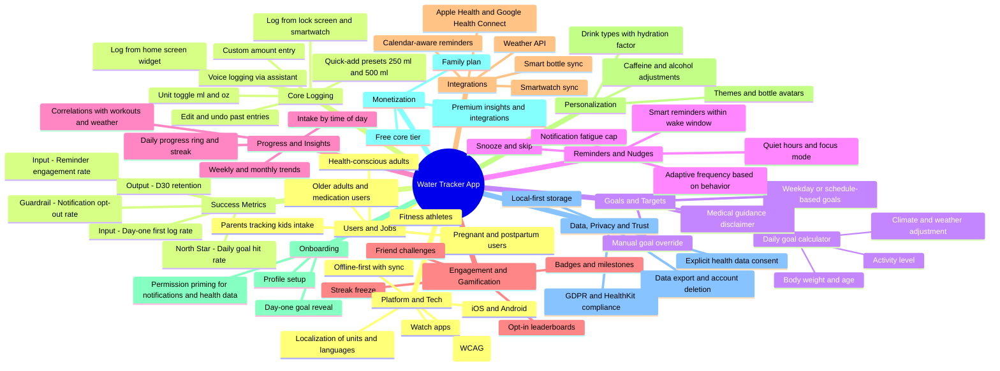

# Water Tracker App: Product Mindmap

Draft for discovery and scoping. Renders in GitHub, Notion, and VS Code (Mermaid support).

## Suggested MVP cut (for discussion)

| Scope | Branches |
|---|---|
| MVP | Core Logging, Goals and Targets (manual + basic calculator), Reminders (basic), Progress (daily and weekly), Onboarding, Data and Privacy baseline |
| Phase 2 | Integrations (Health apps, weather), Engagement and Gamification, Personalization |
| Phase 3 | Insights correlations, Monetization tiers, Smart bottle sync, Family plan |

## Open questions to validate

1. Is the goal calculator a medical-adjacent feature? Confirm review and disclaimer requirements with Legal before launch.
2. Health data (Apple Health, Health Connect) triggers platform review and consent requirements. Confirm data-handling scope with Privacy and Security.
3. Which persona is the primary bet for MVP?
4. Does reminder adaptivity need ML, or are rules enough for v1?
